<!--
  noName25 // profile README · theme: cyan frames, orange for what matters
  assets/*.svg     : animated panels, rebuilt by scripts/build_*.py
  output/stats.svg : rebuilt every 6h by .github/workflows/profile-stats.yml
-->

  

  
  

  

  

  

